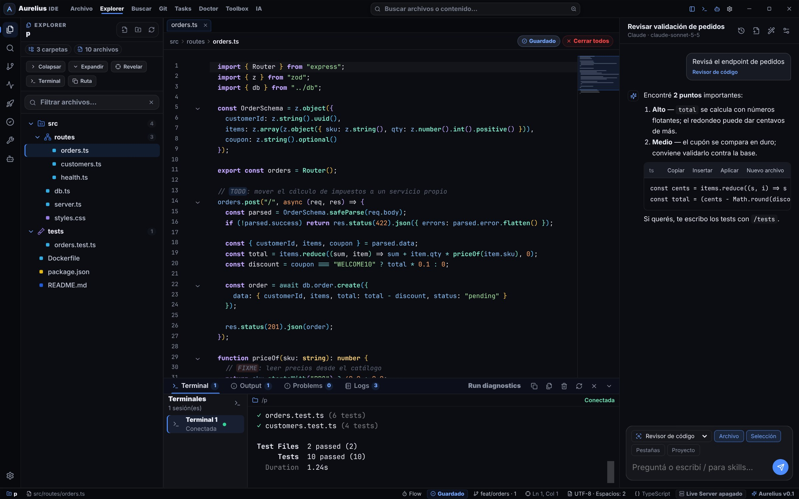
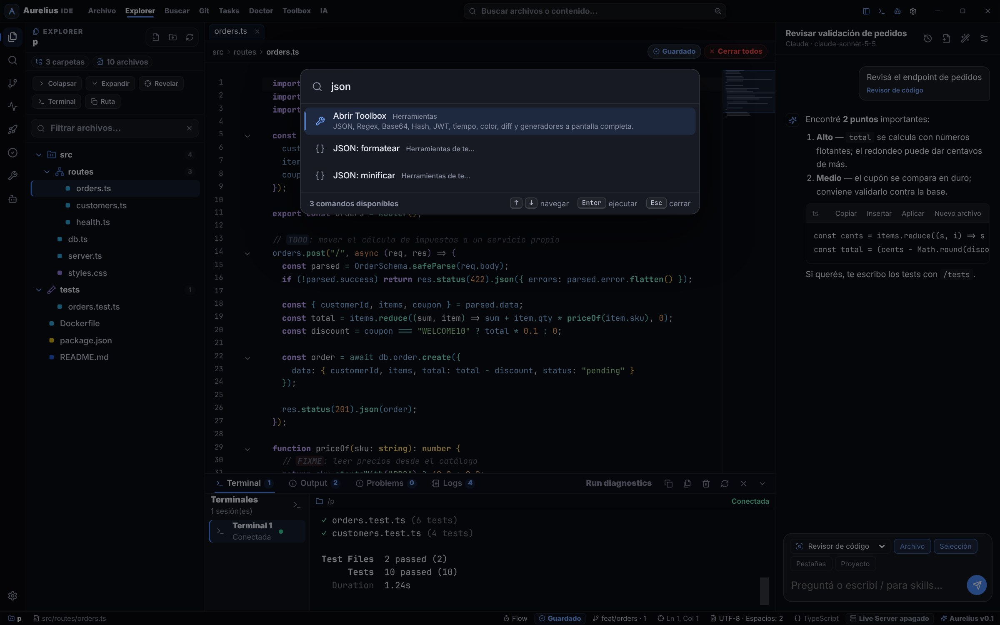
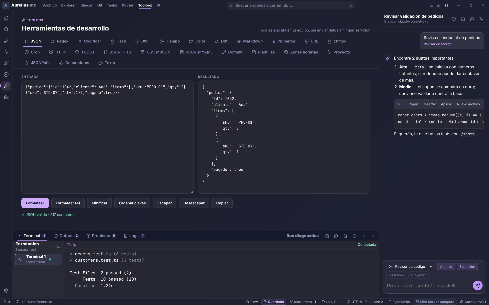
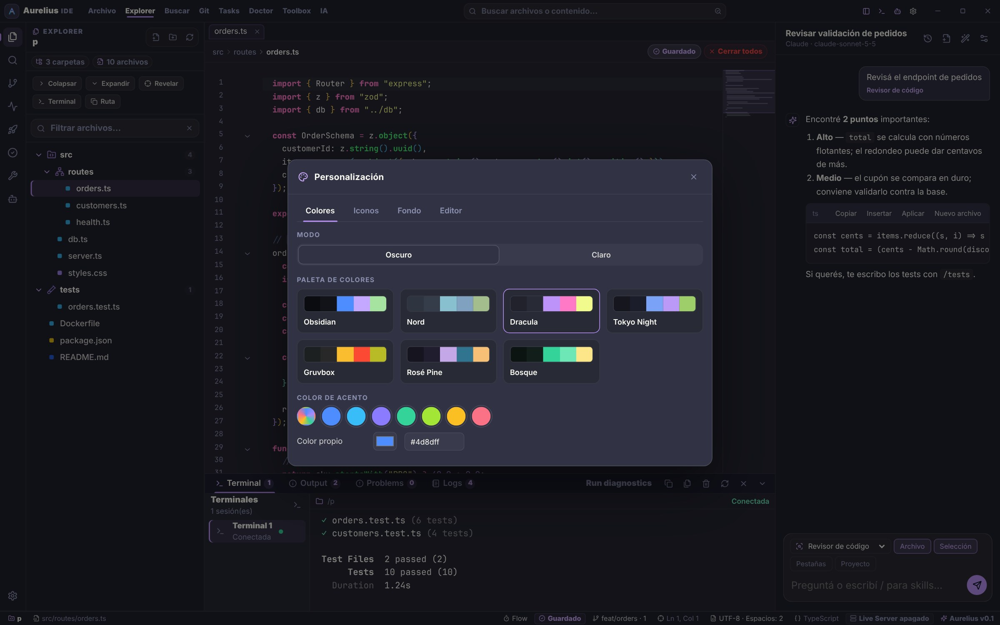
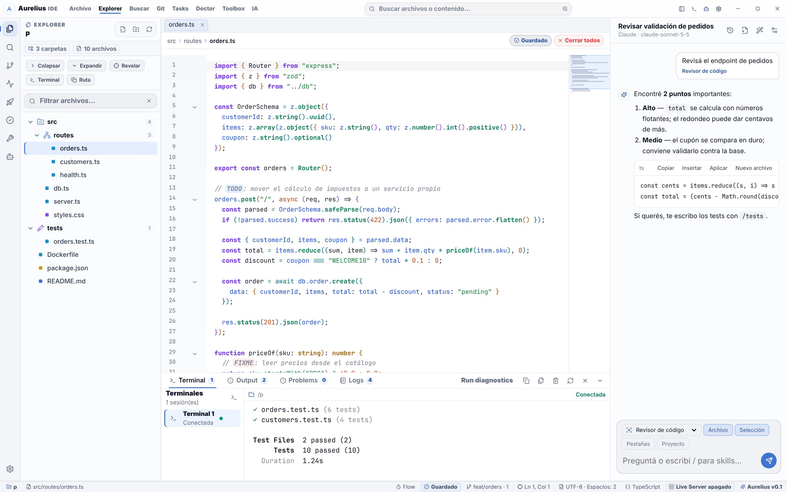

<div align="center">


# Aurelius IDE

**Un IDE nativo, rápido y minimalista para Linux.**
Editor, terminal real, Git, IA con skills y más de 30 herramientas de desarrollo — en una sola ventana, sin Electron.


[Características](#-características) ·
[Instalación](#-instalación) ·
[Atajos](#-atajos) ·
[IA](#-asistente-de-ia) ·
[Arquitectura](#-arquitectura) ·
[Contribuir](#-contribuir) ·
[Changelog](CHANGELOG.md)

<br />



</div>

---

## ✦ Galería

<table>
  <tr>
    <td></td>
    <td></td>
  </tr>
  <tr>
    <td></td>
    <td></td>
  </tr>
</table>

---

## ✦ Por qué Aurelius

| | |
|---|---|
| **Nativo y liviano** | Rust + Tauri sobre WebKitGTK. Abre rápido y consume poco; nada de Electron. |
| **Todo a mano** | Editor, terminal, Git, tareas del proyecto, monitor del sistema y diagnóstico del entorno en la misma ventana. |
| **IA que controlas** | Ollama local, OpenAI, OpenRouter o Claude, con *skills* propias y respuestas en streaming. Tus claves se quedan en tu equipo. |
| **Diseño sobrio** | Superficies planas, líneas finas, paletas y packs de iconos configurables. **Sin glow.** |

---

## ◆ Características

### Editor
- CodeMirror 6 con resaltado para 20+ lenguajes, minimapa, paréntesis arcoíris, muestras de color y marcadores.
- Ir a símbolo (`Ctrl+Shift+O`), archivos recientes, historial local con diff, snippets, vista previa de Markdown.
- Buscar y reemplazar en todo el proyecto, comparar pestañas y ver cambios sin guardar.
- **40+ transformaciones de texto** desde la paleta: casos (camel, snake, kebab, Title…), ordenar/deduplicar/numerar líneas, JSON ⇄ array, escapar HTML, Base64/URL, estadísticas, `console.log` de la selección…

### Terminal
- xterm.js sobre un PTY real, con varias sesiones, búsqueda (`Ctrl+F`), enlaces clicables y Unicode 11.
- Salida agrupada por frame: fluida incluso con builds y logs masivos.
- Panel *Problems* que detecta errores de compilación en la salida.
- Renderer WebGL opcional (comando de paleta) para equipos con buena GPU.

### Centro de Git (`Ctrl+Shift+G`)
- Cambios con *stage / unstage / descartar* por archivo y diff a color.
- Commit, *amend*, *commit y push* y **mensaje de commit generado con IA**.
- Historial con detalle de cada commit, ramas, *stash*, fetch / pull / push.
- Backend en Rust con lista blanca de subcomandos, timeout y límite de salida.

### Páginas a ancho completo
| Página | Qué hace |
|---|---|
| **Monitor** | CPU, memoria, procesos, discos, red, batería y uptime; historial y auto-actualización. |
| **Tasks** | Detecta scripts de Node, Cargo, Make, Docker… con favoritas e historial de comandos. |
| **Doctor** | Verifica 26+ herramientas del sistema y genera un reporte copiable. |
| **Toolbox** | 30+ utilidades locales (ver abajo). |
| **Ajustes** | Tema, paleta, iconos, fondo animado, editor, IA, privacidad, exportar/importar. |

### Toolbox
JSON · JSONPath · Regex · Codificar · Hash · JWT · Tiempo · Zonas horarias · Color · Contraste WCAG · Diff · Markdown · Números · Unidades CSS · URL · chmod · Cron · HTTP · SemVer · Referencia HTTP · `.gitignore` · Datos de prueba · Chuleta de Git · JSON→TS · CSV · YAML · `.env` · Escapar texto · SQL · Imagen→Base64 · Gradiente CSS · cURL→fetch · Commit · Plantillas · Generadores · Texto · Proyecto.

### Proyectos
- **Nuevo proyecto** con 9 plantillas (Vite, React, Vue, Node, Rust, Python, Go, HTML) y **clonar repositorio**.
- Live Server con detección de raíz y *Project Commands* inteligentes.

### Personalización
Paletas de color, packs de iconos, superficies *Midnight* (AMOLED) y *Graphite*, fondos con animación o imagen propia, modo Zen, Flow timer (Pomodoro) y scratchpad.

---

## ◇ Asistente de IA

Panel lateral (`Ctrl+I`) con conversaciones, historial y **skills** editables (revisor de código, tests, documentación, refactor, seguridad, commit…). Escribe `/` para invocarlas.

| Proveedor | Notas |
|---|---|
| **Ollama** | Local, sin clave ni red. |
| **OpenAI** | Clave propia. |
| **OpenRouter** | Cualquier modelo; clave propia. |
| **Claude** | API de Anthropic; clave propia. |

Puedes incluir como contexto el archivo, la selección, las pestañas o el árbol del proyecto, y aplicar el código de una respuesta con vista previa del diff. Ajustes → IA incluye **Probar conexión**.

---

## ▣ Instalación

### Requisitos (Arch / Omarchy)

```bash
sudo pacman -S --needed base-devel curl wget file openssl appmenu-gtk-module \
  gtk3 webkit2gtk-4.1 librsvg nodejs npm
curl --proto '=https' --tlsv1.2 -sSf https://sh.rustup.rs | sh
```

En Debian/Ubuntu instala los equivalentes de Tauri 2 (`libwebkit2gtk-4.1-dev`, `libgtk-3-dev`, `librsvg2-dev`, `build-essential`, `curl`, `wget`, `file`).

### Desarrollo

```bash
git clone https://github.com/MatiasFrutos/Aurelius-IDE.git
cd Aurelius-IDE
npm install
npm run tauri dev
```

### Compilar e instalar

```bash
npm run tauri build
```

Los paquetes quedan en `src-tauri/target/release/bundle/`:

```bash
# AppImage
chmod +x src-tauri/target/release/bundle/appimage/*.AppImage
./src-tauri/target/release/bundle/appimage/*.AppImage

# Debian / Ubuntu
sudo dpkg -i src-tauri/target/release/bundle/deb/*.deb && sudo apt install -f

# Binario directo
./src-tauri/target/release/aurelius-ide
```

Para Arch hay un `PKGBUILD` en [`packaging/arch`](packaging/arch).

---

## ⌘ Atajos

| Acción | Atajo |
|---|---|
| Abrir proyecto · Guardar · Nuevo archivo | `Ctrl+O` · `Ctrl+S` · `Ctrl+N` |
| Quick Open · Paleta de comandos | `Ctrl+P` · `Ctrl+Shift+P` |
| Ir a símbolo · Ir a línea | `Ctrl+Shift+O` · `Ctrl+Alt+G` |
| Explorer · Terminal · Panel IA | `Ctrl+B` · `Ctrl+J` · `Ctrl+I` |
| **Centro de Git** | `Ctrl+Shift+G` |
| Ayuda de comandos | `Ctrl+K` |
| Cerrar pestaña | `Ctrl+W` |
| Modo Zen · Apariencia | `Alt+Z` · `Alt+A` |
| Historial local · Scratchpad · Flow timer | `Alt+H` · `Alt+J` · `Alt+T` |
| Marcador · Ajuste de línea · Diff sin guardar | `Alt+B` · `Alt+W` · `Alt+D` |
| Terminal: buscar · limpiar | `Ctrl+F` · `Ctrl+Shift+K` |

---

## ▤ Arquitectura

```text
┌───────────────────────── Frontend (Vite · JS · CSS) ─────────────────────────┐
│  Editor (CodeMirror 6) · Terminal (xterm.js) · Centro de Git · Toolbox · IA   │
│  services/*.js  ──────────────  invoke() / listen()  ─────────────┐           │
└────────────────────────────────────────────────────────────────────┼──────────┘
                                                                     ▼
┌───────────────────────────── Backend (Rust · Tauri 2) ──────────────────────┐
│  fs · terminal (PTY) · git/shell (lista blanca) · tareas · monitor · IA SSE   │
└───────────────────────────────────────────────────────────────────────────────┘
```

```text
src/               frontend (app/, components/, ai/, services/, styles/)
src-tauri/src/     backend (commands/ expone Tauri commands; core/ contiene la lógica)
packaging/arch/    PKGBUILD para Arch Linux
docs/store/        ficha y capturas para publicación
```

Principios: el frontend nunca ejecuta comandos arbitrarios; todo pasa por *commands* de Rust con validación, lista blanca, timeouts y límites de salida.

---

## ✓ Calidad

El frontend se prueba con suites e2e de Playwright (Tauri simulado y `git` real en repositorios temporales); el backend de shell/Git se valida con tests de Rust. `npm run build` debe pasar antes de cada PR.

---

## ➜ Roadmap

- [x] Editor, terminal, Git, IA con skills, Toolbox, Monitor, Doctor
- [x] Centro de Git, nuevo proyecto / clonar, personalización completa
- [ ] Estabilidad y pruebas en más distribuciones Linux
- [ ] Panel *Problems* y Git más profundos
- [ ] Empaquetado y publicación de instaladores
- [ ] Mejor guardado/restauración de sesión

---

## ◈ Contribuir

El proyecto funciona pero aún necesita trabajo. Se agradece ayuda en: **estabilidad, UI/UX, rendimiento, terminal, integración de IA, builds y pruebas en distintas distros, documentación y revisión de código**. Abre un *issue* o un *pull request*; describe qué cambia y cómo lo probaste.

---

## ⚖ Licencia y transparencia

Aurelius IDE **no es open source** en el sentido de licencia libre: el código se publica para que sea **legible, auditable y revisable**, pero no se otorgan permisos automáticos de uso comercial, redistribución o copia como proyecto propio sin autorización.

> Aurelius es una herramienta personal en evolución, ofrecida *tal cual*: haz copias de seguridad de tu trabajo.

---

<div align="center">

Hecho con Rust, Tauri y CodeMirror · [Historial de cambios](CHANGELOG.md)

</div>
